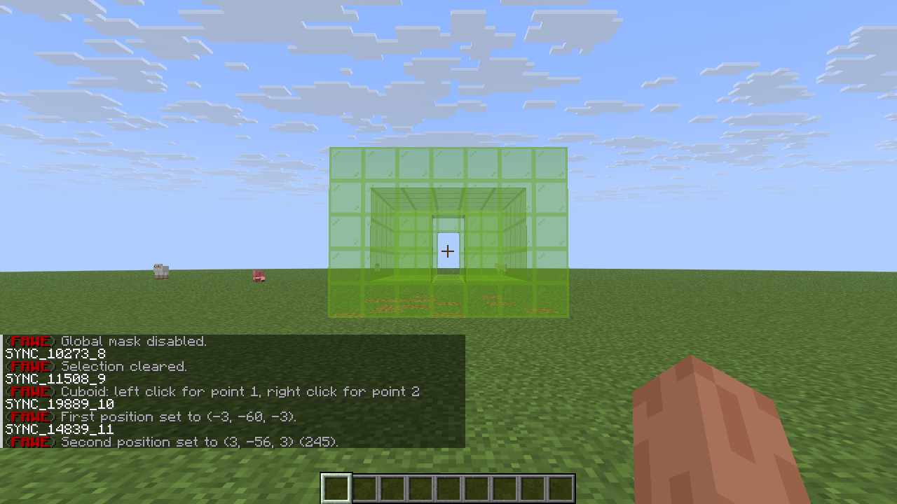
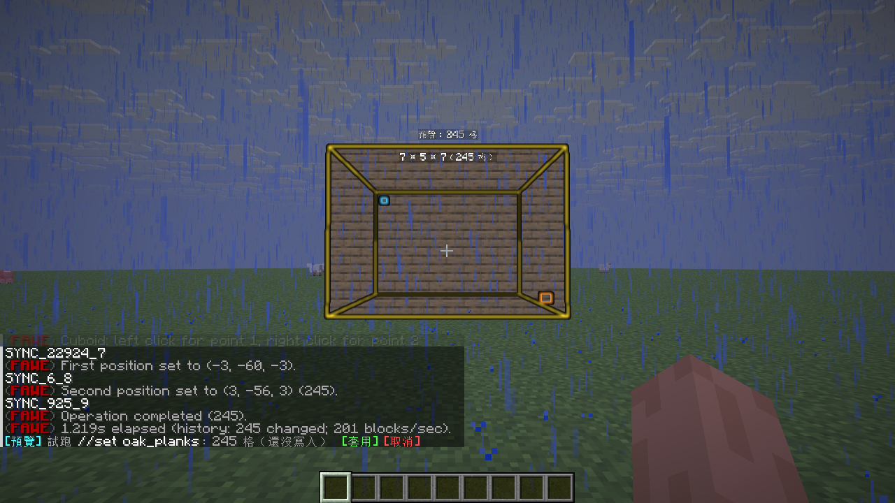
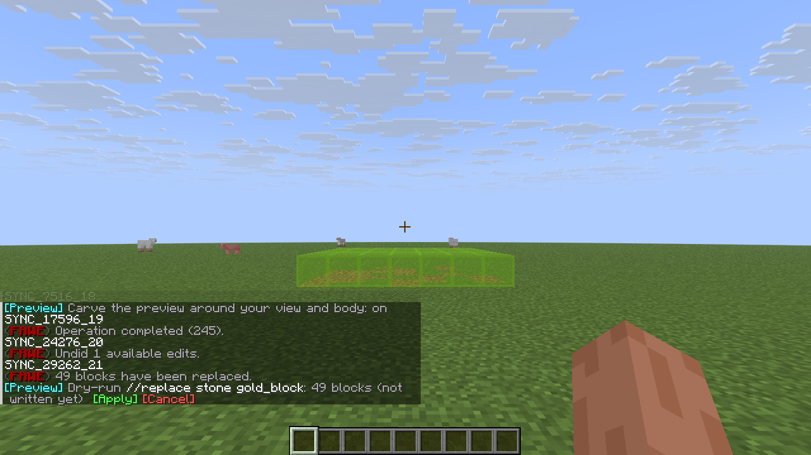
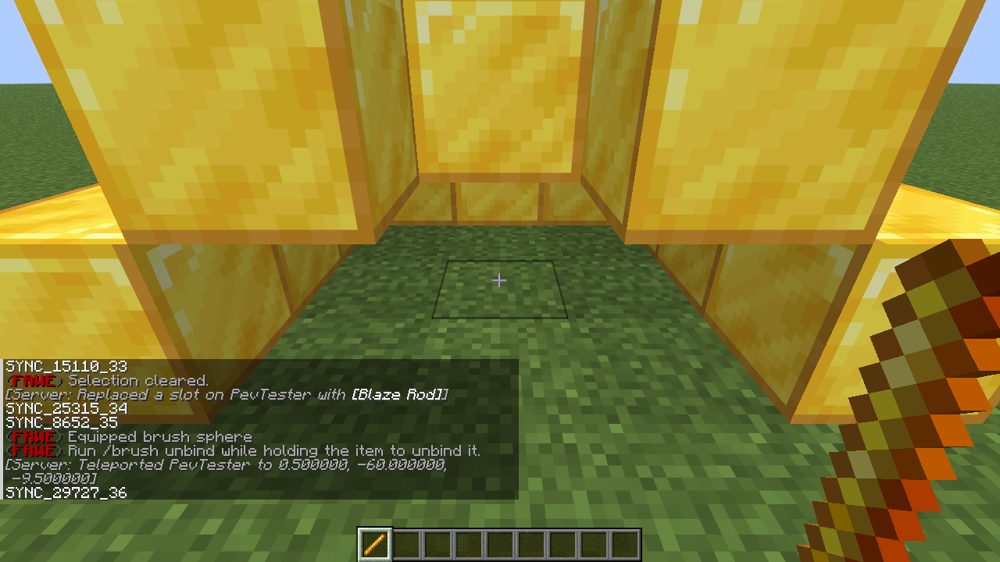
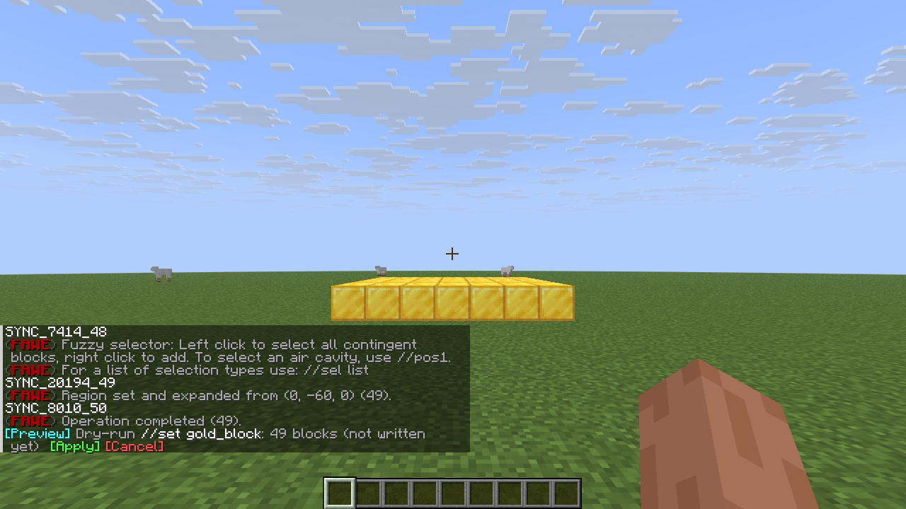
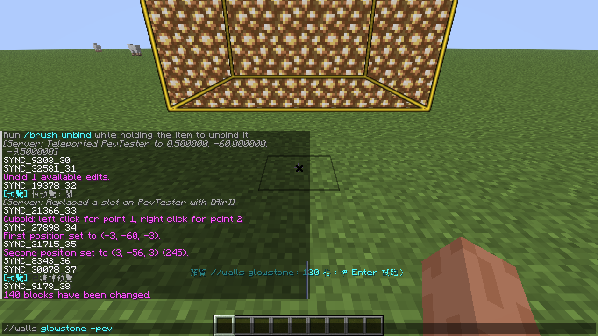

# EditPreview

"Look before you write" block previews for WorldEdit / FastAsyncWorldEdit: command dry-runs, live typing previews,
brush aim previews and a brief lime-glass flash of every new selection.
Selection outlines are left to other plugins (WorldEditCUI, WorldEditDisplay, …); this plugin draws no lines at all.
Previews are sent only to the player who made them (fake blocks), never touch the world, and leave no `//undo` history.

- Paper 1.21.x (uses `AsyncTabCompleteEvent`, `sendMultiBlockChange`), Java 21
- WorldEdit 7.4+ or FastAsyncWorldEdit 2.x (either one)

| Selection flash | Dry-run `//set` | `//replace` mask (lime glass) | Brush | Magic select (FAWE) | Typing `-pev` |
|---|---|---|---|---|---|
|  |  |  |  |  |  |

## Features

- **`-pev` / `--pev` dry-run**: append `-pev` (or `--pev`) to any block-changing WorldEdit command
  (e.g. `//set stone -pev`, `//replace dirt grass_block --pev`). The command runs as usual, but every write is intercepted
  and shown as a preview instead, with **[Apply]** / **[Cancel]** buttons. The preview disappears after 5 seconds
  (`dry-run-timeout`); put a number of seconds right after the flag to choose per command: `//set stone -pev 30` keeps
  it for 30 s, `-pev 0` until you clear or apply it. Commands without the flag always run for real.
  - **Preview while typing**: as soon as `-pev` appears in the chat box (before Enter), the preview starts.
    `//set` and `//replace` update on every keystroke; other commands (`//walls`, `//stack`, `//smooth`, …) are dry-run
    once in capture mode after typing pauses for 0.6 s. Deleting `-pev` clears the preview.
    Commands that change the clipboard (`//cut`) or move the selection with `-s` (`//move`, `//stack`, `//paste`)
    are not dry-run while typing; press Enter to dry-run them.
- **Always-preview** (`/pev always on`): live previews without typing the flag. Pressing Enter still runs the command
  for real; add `-pev` / `--pev` when you want a dry-run.
  - **Live typing preview**: typing `//set <pattern>` shows the pattern result live; typing `//replace <mask>` marks the
    blocks that would be replaced in lime glass, and once you type `<pattern>` it becomes a real block preview.
  - The two typing stages can be turned on and off separately: `/pev live mask` (the `//replace` mask as lime glass) and
    `/pev live pattern` (the `//set` / `//replace` pattern as real blocks). With only the mask stage on, typing
    `//replace stone diamond_block` keeps showing which blocks will be replaced. Typing `-pev` always shows both.
  - **Brush**: holding a brush and aiming shows the result of that stroke; clicking writes as usual.
- **Selection flash** (`/pev select`, on by default, independent of always-preview): whenever a selection is completed
  or changed, its exposed blocks flash as lime glass for 3 seconds — any selector shape, including FAWE magic select.
- **Carving** (`/pev carve`, on by default): fake blocks along your line of sight and around your body are hidden, so a
  preview never gets in the way of clicking, placing positions or moving around.
- **Masks**: `//gmask`, `-m` masks and brush masks are always respected. `replace`-like commands and masked edits show
  "affected blocks" as translucent lime glass by default; everything else shows the resulting blocks
  (change it with `/pev style`).
- **Custom masks and patterns**: typing previews parse with WorldEdit's own mask / pattern factories, so masks and
  patterns that other plugins register there (and FAWE's own, e.g. `#linear[...]`) are previewed too. Dry-runs capture
  the command's real writes, so they work with anything the command accepts.
- **Any selection works**: the preview is the command's real writes, independent of the selection shape; FAWE magic
  select (`//sel fuzzy`), polyhedral, etc. all work.
- FAWE operations that need `//confirm`: after confirming they are previewed the same way.

## Commands

Permission `editpreview.use` (everyone by default). Each player's settings are saved immediately to
`plugins/EditPreview/players/<uuid>.yml`, so they survive rejoins, restarts and even crashes
(settings from older versions are migrated automatically).

| Command | Description |
|---|---|
| `/pev always [on\|off]` | Always-preview (live typing and brush previews; Enter still executes) |
| `/pev brush [on\|off]` | Brush preview |
| `/pev live <mask\|pattern> [on\|off]` | Typing preview stages: `//replace` mask as lime glass / pattern as real blocks |
| `/pev select [on\|off]` | Lime-glass flash of new selections |
| `/pev carve [on\|off]` | Carve the preview around your line of sight and body |
| `/pev style <auto\|blocks\|glass>` | Preview style: automatic / always real blocks / always lime glass |
| `/pev apply` | Apply the current dry-run (re-runs the original command) |
| `/pev clear` (`cancel`) | Clear the preview |
| `/pev mask <mask>` | Mark blocks in the selection that match a mask, as lime glass |
| `/pev pattern <pattern>` | Preview the selection with a pattern applied, with an [Apply //set] button |
| `/pev help` | Help |

Not intercepted: `//undo`, `//redo`, selection / brush / tool / mask settings, teleports (`/up`, `/ascend`, …) and other
commands that change no blocks.
Not previewable: `//butcher`, `//remove` (entity removal bypasses block writes and cannot be intercepted; with `-pev`
they are blocked).

## Configuration (config.yml)

```yaml
max-capture: 1000000     # max blocks captured per dry-run (beyond this still nothing is written, just not shown)
max-display: 150000      # max fake blocks sent (beyond this, the blocks nearest to the player are kept)
live-max-volume: 262144  # typing preview pauses above this selection volume (Enter still dry-runs)
brush-max-size: 32       # brushes larger than this are not previewed
dry-run-timeout: 5       # seconds before a dry-run preview disappears (0 = keep until cleared; per command: -pev N)
selection-flash:
  ticks: 60              # flash duration (20 ticks = 1 second)
  max-volume: 262144     # larger selections don't flash
defaults:                # per-player defaults
  always: false
  brush: true
  live-mask: true
  live-pattern: true
  selection-flash: true
  carve: true
```

## How it works

- **Intercepting writes**
  - WorldEdit: at the `BEFORE_HISTORY` stage of `EditSessionEvent` a `CaptureExtent` records writes and does not pass
    them on; reads return the recorded result first (so later steps of the same command see earlier changes).
    The mask is taken from the underlying `MaskingExtent`.
  - FAWE: at `BEFORE_CHANGE` the queue is located and an `IBatchProcessor` (scope `CUSTOM`: after masks, before
    history) records each chunk's writes and then empties the batch, so neither the world nor history changes.
    Falls back to `CaptureExtent` if no queue is found.
- **Trigger**: `PlayerCommandPreprocessEvent` detects `-pev` / `--pev`, strips the flag and lets the command run in
  capture mode; [Apply] re-runs the original command without the flag.
- **Typing preview**: the client requests completions on every keystroke; `AsyncTabCompleteEvent` provides the current
  chat buffer, and after a 250 ms pause it is evaluated on the selection with WorldEdit's mask / pattern parsers.
- **Brush preview**: follows `BrushTool` (aim, size, material, mask) with its own EditSession calling `brush.build`,
  with all writes intercepted.
- **Selection flash**: the player's WorldEdit selection is polled every 4 ticks; when it changes to a complete region,
  the region is shown as lime glass (only exposed blocks are sent).
- **Display**: previews are `sendMultiBlockChange` fake blocks; fully enclosed blocks are not sent. Carving recomputes,
  every 2 ticks, which fake blocks lie in a tube along the line of sight (up to the first real block hit) or in a column
  around the player, and sends only the difference.

## Limitations

- A preview is "running the command once": patterns with randomness are re-rolled on [Apply].
- Entity and biome changes are not previewed.
- Typing dry-runs really run the command (just without writing), so WorldEdit messages appear in chat; half-typed
  arguments may produce error messages.
- During a dry-run WorldEdit / FAWE still print "Operation completed (N)" or "history: N changed"; those are just the
  command's own counters — neither the world nor history changed.
- Fake blocks may revert to real blocks on the client when clicked or when chunks reload; `/pev clear` restores them.

## Building and testing

```sh
./gradlew build           # build/libs/EditPreview-<version>.jar
scripts/restart.sh        # deploy to the test server and restart server + client
scripts/e2e.sh            # end-to-end tests (FAWE 2.16.1: 56 checks; WorldEdit 7.4.6: 53, FAWE-only checks skipped)
scripts/persist.sh        # settings survive a server crash (kill -9)
```

The test scripts need a local Paper test server, a Minecraft client, Xvfb and xdotool; paths are in `scripts/env.sh`.

## License

[MIT](LICENSE) © TWME-TW
